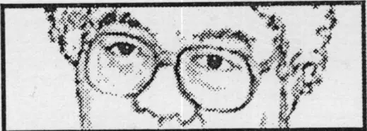

# Halaman Judul

## PERSPEKTIF BARU

## Edisi 126

## MUNIR

Usulan Judul:

## KEKERASAN ADALAH ALAT REJIM YANG KORUP

## Highlight

Waktu Mei kita persoalkan orang diculik ada perubahan secara fundamental. Saya kira dalam kondisi krisis dan pemerintah baru harus populis, mereka mainkan politik populis. Ada keputusan-keputusan politik untuk bongkar ini dan macam-macam, dan saya lebih diuntungkan.

## BOX KETERANGAN RUTIN

PERSPEKTIF BARU kini dirancang khusus untuk media cetak, walaupun Stasion Radio bisa berlangganan rekaman wawancara. PERSPEKTIF BISNIS REPUBLIKA merupakan acara bulanan Talk Show dan kontak bisnis di Jakarta, "mencuri kejernihan dari kerancuan bisnis". PERSPEKTIF LIVE!! digelar atas permintaan masyarakat kota luar Jakarta. Untuk kontak, forum dan informasi Home Page PERSPEKTIF ONLINE dengan alamat http://www.perspektif.net. Wimar dapat juga dilihat di televisi dalam talk show Indosiar, SELAYANG PANDANG tiap Selasa pukul 22:30.

Hak cipta pada InterMatrix, semua keterangan fax (021)722-9994, telepon (021)727-900-28/29/30/31, surat PO Box 4320, KBY JKT 12042, e-mail imx@perspektif.net

---

# Kekerasan adalah Alat Rejim yang Korup

*Perspektif Baru, Edisi 126*

Perspektif Wimar: Munir SH dulu tidak terlalu terkenal. Ia sering ada di berita koran dan televisi, tapi tidak pernah berceritera mengenai dirinya. Ia tidak menjadi public figure yang diikuti orang diluar pekerjaannya. Tapi kemudian pekerjaan Munir menjadi topik yang paling penting di negara ini. Munir adalah titik fokus dan motor penggerak perjuangan tanpa kenal lelah dalam usaha menemukan korban penculikan, dan mencari pihak yang bertanggung jawab dalam penculikan. Melalui KONTRAS, Munir dan rekan-rekannya dalam jaringan yang luas membuat sejarah dengan membongkar kekejian suatu rejim pada saat rejim itu sedang berkuasa. Mulailah kita biasa melihat satu orang Munir yang mengejar-ngejar soal penculikan ini sepertinya tanpa lelah, tanpa tahu resiko. Kalau kita lihat koran-koran dan majalah mulai mengarah pada pemain-pemain utama dalam skandal penculikan (dan karenanya juga orang yang merekayasa gelombang perusakan, kekerasan dan perkosaan), maka teringatlah kita pada fakta sejarah, bahwa perjuangan selalu dijiwai oleh satu orang. Kalau ada satu 'hero' dalam perjuangan rakyat hari ini, maka Munir adalah orangnya. Ia mewakili sekian juta orang biasa yang melakukan kegiatan publik bukan untuk dirinya, bukan juga untuk suatu tujuan melawan satu pihak, bukan juga mencari kemenangan, karena kekerasan tidak akan hilang dari muka bumi selama ada negara yang diperebutkan oleh orang yang tega menikmati hidup diatas derita dan perusakan Mungkin Munir tidak akan setuju dengan pujian ini, karena katanya pekerjaan dia belum selesai, bahkan makin lama makin banyak terungkap kasus penculikan berdasarkan kebijaksanaan kekuasaan. Tapi kami 'terpaksa' mengeluarkan pujian ini, karena kepala kita sudah terlalu penuh dengan omelan, dengan frustrasi, dengan pesimisme. Kita menghadapi orang Indonesia yang main-main dengan uang Rp 26 Milyard untuk berpolitik dengan Soeharto, menteri yang dengan enteng mengeluarkan komentar asalan mengenai penjarahan 5%. Kita menghabiskan energi mengganti kekuasaan lama dengan menghadapi kekuasan baru yang pandai memainkan emosi publik tapi tidak bisa membawa solusi untuk krisis kehidupan masyarakat. Kita perlu seorang Munir untuk mengingatkan kita akan kata-kata Anne Frank bahwa sebetulnya, dalam hatinya, semua orang itu baik. Paling tidak, kalaupun kita punya ribuan orang yang bisa menjarah, membakar, memperkosa dan membunuh, kita juga punya orang berkualitas Hadiah Nobel atau Hadiah Magsaysay. Ikutilah ungkapan munir dengan seorang pemujanya, Wimar Witoelar, pemandu Perspektif Baru

## Apa anda merasakan masa sekarang ini sebagai masa keberhasilan pengungkapan penculikan-penculikan itu?

Itu tergantung beberapa ukuran keberhasilan, karena menurut saya, temuan kasus penculikan ini terlalu jauh dari maksimal. Artinya persoalan penculikan di Indonesia masih jauh lebih luas dari apa yang kemarin dibuka. Bagi saya tidak begitu penting yang kena jenderal berapa, tapi saya lebih melihat apakah politik kekerasan bisa berhenti atau tidak di negeri ini. Orang banyak melihat di kasus ini ada kemajuan, dimana kasus-kasus yang biasanya melibatkan aparatur negara hampir akan selalu terhambat oleh keputusan-keputusan politik, sehingga tidak terbongkar, seperti kasus Marsinah atau kasus Udin.

Kasus Marsinah itu termasuk kasus-kasus yang pertama yang Bang Munir tangani. Kapan dan bagaimana anda mulai terjun ke dalam bidang yang sangat unik ini?

Sejak mahasiswa saya aktivis di kampus, kebetulan dulu membantu di pos LBH di Malang Saya membantu mereka sebagai volunteer, disitu saya bertemu dengan berbagai persoalan-persoalan kekerasan. Ada petani yang menjadi korban kekerasan karena mempertahankan tanahnya, dan semacam itu. Dalam proses itu saya banyak mendampingi buruh, dan skripsi saya juga tentang buruh. Saya banyak terjun ke kampung-kampung buruh untuk mengetahui problem mereka. Mengenai kasus penculikan baru beberapa tahun terakhir ini saya tangani. Selama itu saya memahami benar betapa buruh dan petani berhadapan dengan politik kekerasan dan dengan kekuatan negara. Sebenarnya tahun 1991, saya sudah dikejar-kejar gara-gara saya mendampingi buruh dan melakukan berbagai upaya untuk mempersoalkan kekerasan. Tahun 1992 saya buat training buruh, kemudian 3 buruh yang saya training hilang. Setelah beberapa ketemu, dia sudah babak belur dihajar aparat, diantaranya dilecehkan secara seksual. Sampai hari ini ketiga-tiganya nggak berani memper soalkan hal itu. Salah satu dari mereka membentuk keyakinan saya bahwa hal ini menjadi persoalan yang harus dikedepankan, dan harus ada yang mengambil posisi itu.

Ada efek bola salju juga, semakin anda giat dan terkenal, semakin berat kasus yang anda hadapi dan semakin besar bahayanya. Apa tidak ada kekuatiran pada suatu saat akan tercapai batas keamanan untuk anda pribadi, karena toh kekerasan dan kekejaman seakan tidak ada batasnya untuk suatu rejim yang keras?

Saya melihatnya ada dua persoalan, keyakinan dan taktis. Persoalan keyakinan bagi saya sepanjang ada teror terhadap kehidupan masyarakat termasuk pada diri saya sendiri itu menunjukan pekerjaan masih panjang yang harus diperjuangkan. Artinya bagi saya politik ini yang harus saya selesaikan, nggak mungkin untuk menghindari itu. Kalau itu saya hindari berarti pekerjaan saya gagal. Kedua, saya juga melihat bahwa sejak beberapa tahun ini orang melihat hidup saya nyerempet-nyerempet bahaya. Saya pernah diancam seorang jenderal secara formal mau dibunuh. Mungkin titik-titik kritis ini telah saya alami. Justru di kasus culik ini titik kritis itu belum. Kalau kemudian saya harus mulai menyentuh orang hilang di Aceh misalnya, di Lampung, saya akan menghadapi titik kritis itu. Tapi sampai hari ini belum sampai pada titik kritis itu.

Dalam kasus penculikan aktivis politik menjelang jatuhnya Soeharto, apa belum ada ancaman-ancaman terlalu berat? Kira-kiranya apa sebabnya yang membedakan kasus ini dari kasus buruh ?

Sebetulnya pada tingkat awal penculikan yang sekarang ini kita persoalkan, ancamannya sudah cukup berat dan mempunyai titik balik ketika Soeharto jatuh. Kita mulai keras berhadapan hampir secara frontal sekitar tanggal 2 sampai tanggal 10 Mei, ketika ABRI sudah mulai menuduh saya mendeskreditkan ABRI. Kemudian saya dianggap menyebarkan berita bohong dan macam-macam. Waktu Mei kita persoalkan orang diculik ada perubahan secara fundamental. Saya kira dalam kondisi krisis dan pemerintah baru harus populis, mereka mainkan politik populis. Ada keputusan-keputusan politik untuk bongkar ini dan macam-macam, dan saya lebih diuntungkan. Sementara ada sektor-sektor masyarakat lain yang menghadapi kekerasan dan tidak bisa di kontrol. Kalau itu dipersoalkan akan menghadapi kekerasan juga

Jadi kecenderungan pemerintah untuk populis menguntungkan anda karena anda sekarang seperti mendapat legitimasi yang lebih besar. Mengapa anda katakan begitu, apa anda tidak percaya bahwa pemerintah ini memang tulus, ingin mengatasi kekerasan dan hal semacamnya?

Saya melihat masih ada double standart, dalam artian bahwa dibukanya kasus ini memang ada satu situasi politik yang pemerintah harus lakukan. Jadi bukan tumbuh dari satu kesadaran berbangsa atas komunikasi yang ballance antara kekuatan-kekuatan yang ada. Kemudian menumbuhkan satu proses dimana kita membangun mekanisme tanpa kekerasan, tapi saya lebih melihat posisi defensif yang harus mereka bayar dengan mahal. Saya nggak yakin kalau misalnya kekerasan tidak berlanjut, sebab belum melihat titik-titik perubahan di rejim ini.

Sejauhmana kekerasan itu bisa dibagi tanggung jawabnya antara rejim politiknya dan ABRInya ?

Tidak bisa dipisah. ABRI sendiri bagian dari rejim politik. Apapun kebijakan rejim politiknya ABRI menjadi salah satu pemain penting dalam prosesi itu. Saya tidak melihat pemisahannya yang terlalu besar. Kalaupun kasus ini dibuka oleh suatu kepemimpinan ABRI yang baru, oleh Wiranto misalnya, saya melihat mekanismenya masih lama.

Kalau tentara-tentaranya masih lama, tetapi pimpinan politiknya melalui suatu keajaiban menjadi pimpinan politik yang merakyat, apakah mungkin ABRInya akan bisa dikendalikan dalam kekerasan ?

Kita bisa belajar dari Thailand, dan Chili, yang hanya hidup dua tahun kemudian muncul satu junta militer. Saya kira problem di Indonesia justeru tidak bisa dititipkan pada persoalan pertumbuhan ballancing ditingkat elite. Misalnya Habibie dengan militer untuk tawar-menawar politik. Kemudian memunculkan pemerintahan baru yang lebih demokratis dengan menghindari bentuk-bentuk kekerasan. Tapi saya lebih melihat bahwa saat ini masih belum tumbuhnya satu kekuatan politik masyarakat dari yang berbasis pada masyarakat, yang bisa duduk ballance dengan kekuatan-kekuatan yang ada. Memang ada kecenderungan rejim lama masih terlalu kuat.

Dengan perkataan lain pekerjaan Bang Munir tidak akan selesai-selesai?

Saya kira masih panjang. Makanya kita pilih KONTRAS, huruf S dibelakangnya itu kan kata beberapa teman artinya Soeharto, kalau Soehartonya turun kan sudah selesai. Padahal S disitu kan security approach, pendekatan keamanan tanpa Soehartopun bisa terjadi.

Kita tahu Munir, kita tahu KONTRAS, dan rasanya hasil yang dicapai itu terlalu besar untuk dicapai satu orang. Jenis-jenis dukungan dan bantuan apa yang paling berguna dalam perjuangan anda?

Pertama, nggak mungkin saya melakukan ini sendiri. Saya didukung oleh 12 LSM yang selama ini punya concern pada persoalan hak. Kemudian yang kedua, ada 2 ormas mahasiswa yang mendukung prosesi itu, intelektual dan rohaniawan juga muncul di Kontras seperti M. Siradj Karlina Leksono dan sebagainya yang duduk di barisan dewan penasihat Kontras. Di tingkat Internasional ada beberapa organisasi yang memberikan dukungan, kita sekarang itu representasi dari ICJ ( International Juris Commission), dari amnesti, dan ada satu di tingkat Asean yaitu Regional Council of Human Right. Kemudian juga saya didukung oleh masyarakat. Media massa merupakan kontributor yang sangat besar pada pekerjaan saya, disamping masyarakat yang sebagian besar adalah volunteer, dari ibu rumah tangga sampai kelompok-kelompok profesi.

Untuk unsur teknisnya seperti teknis investigasi, mencari data, mengklopkan testimony atau keterangan. Ketrampilan teknisnya itu diperoleh dengan cara apa?

Kita ada tim 14 orang dari berbagai LSM, hukum, dan memang mereka rata-rata terlatih menghadapi kasus sebelumnya. Mereka sudah terlibat di kasus Marsinah, Udin dan macam-macam. Jadi ketrampilan-ketrampilan itu dan kemampuan kita mempersoalkan kasus-kasus lama, plus refleksi kita terhadap kegagalan kita yang sudah-sudah memberi warna bagi bentuk tampilan advokasi kita selama ini, tampilan hasil investigasi kita.

Kembali kepada kejadian sekitar sekitar bulan Mei, kalau masyarakat awam melihatnya pertama sebagai letupan massa, kekerasan ABRI, rekayasa politik, dan akhirnya sekarang yang sangat santer adalah adanya rasialisme. Kemudian tema rasialisme itu kalah oleh gerakan politik. Sebetulnya kalau anda bisa simpulkan bahwa kejadian sekitar 14 Mei itu awal-awalnya dari mana sebetulnya ?

Peristiwa 14 Mei itu suatu peristiwa prematur politik. Ada satu kondisi nasional dimana mulai tumbuhnya bentuk-bentuk koreksi yang lebih meluas dan berkembangnya tingkat kesadaran masyarakat. Masyarakat kita sudah melampaui titik batas keberanian mereka yang selama ini sulit. Kita selalu melihat politik kerusuhan selalu menyelesaikan problem itu. Daya kritis yang mulai tumbuh itu selalu akan selesai dengan politik kerusuhan. Bagi saya tanggal 14 Mei itu suatu skandal politik kerusuhan yang membuat proses demokratisasi di negara ini prematur. Pasca itu kita dapat lihat kemudian melemahnya kekuatan-kekuatan dan membangun traumatik di dalam masyarakat sendiri terhadap tuntutan-tuntutan perubahan.

Jadi pihak yang melakukan gerakan politik itu boleh dibilang berhasil dalam mem 'pre-empt'(mendahului) gerakan demokrasi?

Saya kira itu. Salah satu keberhasilan untuk memotong gerakan proses demokratisasi negeri ini adalah menarik garis kerusuhan.

Apa yang bisa dilakukan untuk menghindari itu, kalau sekarang masyarakat sudah tahu bahwa yang terjadi itu adalah satu skenario politik. Apakah sekiranya orang Indonesia ini akan lebih tergugah untuk tidak ikut skenario politik andaikata diupayakan suatu kejadian serupa di masa yang akan datang ?

Saat ini yang penting itu ada beberapa aspek. Pertama problem heterogenitas masyarakat kita tidak boleh menjadi pemelihara konflik horisontal antara masyarakat. Ini menjadi tanggung jawab semua. Sumber utama konflik horisontal selalu dihidup-hidupkan untuk menjaga ballancing, kemudian kerusuhan menjadi suatu pola. Bagian dari proses demokratisasi adalah bagaimana memunculkan kekuatan-kekuatan yang mampu melunakan konflik horisontal, paling tidak ditingkat komunikasi. Kedua, masyarakat kita belum mengenal yang namanya gerakan anti kekerasan. Karena saya yakin benar kekerasan itu tidak bisa dilawan dengan kekerasan, kalau sampai hal ini terjadi maka nilai manusia itu sudah tidak ada lagi. Manusia hanya menjadi benda, yaitu data-data statistik yang mati adalah sekian. Yang ketiga dalam proses ke depan dalam instrumen-instrumen pro demokrasi yang bisa dimanfaatkan misalnya media dan lain sebagianya, itu semua bertanggung jawab untuk membangun perspektif daya kritis masyarakat kita terhadap salah satu kesadaran politiknya. Mereka harus memahami bahwa problem mereka itu problem struktural karena penguasaan akses-akses oleh negara, bukan problem rasialisme dan macam-macamnya. Ketiga hal tersebut yang perlu diperhatikan.

Kalau kita fokus pada penculikan politik yang dilakukan terhadap aktivis mahasiswa dan aktivis pro demokrasi, yang masih belum jelas bagi saya maksud mereka yang melakukannya itu, sebetulnya apa ? dan kalau sudah diculik mau diapakan?

Kita harus melihat termin penculikannya dulu. Kalau hasil analisa kita itu ada tiga termin penculikan saat ini. Termin penculikan pertama itu disekitar pemilu, ada 6 orang yang diculik. Termin penculikan yang kedua pada sidang MPR, dan termin penculikan ketiga sekitar jatuhnya Soeharto. Bagi saya ini motif politiknya jelas bahwa penculikan ini bagian dari upaya pengamanan agenda-agenda.

## Kira-kira orangnya sama yang melakukannya ?

Pelakunya sama karena mereka bertemu di tempat yang sama antar korban. Misalnya ada yang waktu hilangnya saat Pemilu bertemu dengan angkatan yang beda di tempat yang sama. Saya melihat ini persoalan motif politik, jadi ini bukan sebagai salah prosedur atau permainan orang-orang di bawah. Tapi memang dikehendaki dalam politik kontrol, untuk mengamankan status quo. Untuk kelompok termin dua, kelompok SU MPR. Ini tingkat politiknya lebih tinggi, dibanding kelompok-kelompok yang sebelumnya karena pertanyaan khusus untuk Sidang Umum itu ada tambahan, misalnya " Apakah anda dibiayai oleh LB Moerdani, CSIS, atau Sofyan Wanandi ? ", ada sikap-sikap elite politik yang mencoba ingin lihat apakah aktivis-aktivis bagian dari pertigaan elite itu.

Publisitas besar yang anda berhasil bawa kepada kasus-kasus ini apa kiranya akan mengurangi keberanian pihak-pihak penculik dan kekerasan untuk melakukan hal yang serupa ?

Ini yang agak sulit dibuktikan, kita belajar dari kasus Marsinah jauh lebih besar implikasinya dan prosesnya panjang. Tapi ternyata kekerasan jalan terus. Jadi saat ini kalau misalnya ada satu keputusan politik yang tiba-tiba membalik situasi, bisa saja kemudian publikasi itu dihilangkan dari semua media. Ini reason masih di tingkat reason keputusan politik negara. Sehingga bisa saja situasi yang terbuka ini tidak menghentikan proses politik kekerasan, dan penculikan bukan berarti tidak akan muncul di kemudian hari.

Apakah yang terjadi di Indonesia itu sangat lebih jahat dari pada di negara-negara lain atau masuk rangking mana kita dalam hal ini?

Saya kira Indonesia ini termasuk dalam pemain-pemain dimana tingkat kekerasannya cukup tinggi dibanding negara-negara lain meskipun di negara lain juga hal itu terjadi. Di Argentina beberapa tahun yang lalu, di Chili, Afrika Utara dan Indonesia merupakan bagian-bagian dari prosesi-prosesi itu. Indonesia sangat diuntungkan misalnya tekanan Internasional tidak terjadi karena pelanggaran hak azasi di Indonesia tidak separah di negara lain. Tapi misalnya politik double standart Amerika terhadap persoalan pelanggaran hak azasi dan ekonomi

Anda sebutkan bahwa Amerika mempraktekan double standart dalam hal kekerasan, berarti yang disebut tekanan Internasional membela human right itu bukan dari negara semacam Amerika. Lalu dari mana kalau ada tekanan Internasional itu ?

Justeru negara-negara yang tidak memiliki kepentingan ekonomi langsung terhadap Indonesia yang lebih konsisten untuk mempersoalkan, dan itu yang sampai saat ini menjadi sulit dalam situasi hubungan-hubungan ekonomi antar negara hampir tidak bisa kita temukan negara yang tanpa kebijakan kepentingan-kepentingan ekonomi semacam itu. Ini suatu problem dimana situasi saat ini terjadi, tapi bukan berarti kita sulit cari negara yang benar-benar tulis " human right". Saya tidak percaya itu. Hampir semua negara dan hanya Amerika yang paling menonjol standart nya. Akan tetapi dalam situasi ini memang kita tidak bisa berharap bahwa merekalah yang akan menyelesaikan problem di negara ini meskipun mereka bisa membantu tingkat tekanan pada pemerintah Indonesia ketika posisi ballancing rakyat masih lemah. Saya kira itu menjadi tanggung jawab kita dari dalam sebetulnya untuk memperbaiki keadaan ini.

Apakah ada satu strategi politik yang anda rekomendasikan untuk meminimisasi kemungkinan kekerasan karena secara implisit seperti yang anda katakan semua produk dari politik kekuasaan. Kira-kiranya sistem politik macam apa yang kita perlukan?

Yang kita perlu tumbuhkan adalah pertama sistem bernegara yang berbasis kepada kedaulatan rakyat, dimana demokrasi yang berpijak pada humanitas menjadi standart kehidupan bernegara. Secara teknisi bisa disebut multi partai, tapi itu tidak penting karena yang diperlukan adalah berapa besar mekanisme sistem itu tadi mampu menghargai humanitas. Humanitas itu tidak saja bebas dari kekerasan, berekspresi. Karena saya sangat yakin bahwa rejim yang cenderung menggunakan kekerasan adalah rejim yang korup, sebab kekerasan itu kaki lain dari korup. Jadi kalau negara cenderung menggunakan kekerasan berarti telah membuktikan dirinya sebagai rejim yang korup. Saya kira itu yang nggak bisa dihilangkan.